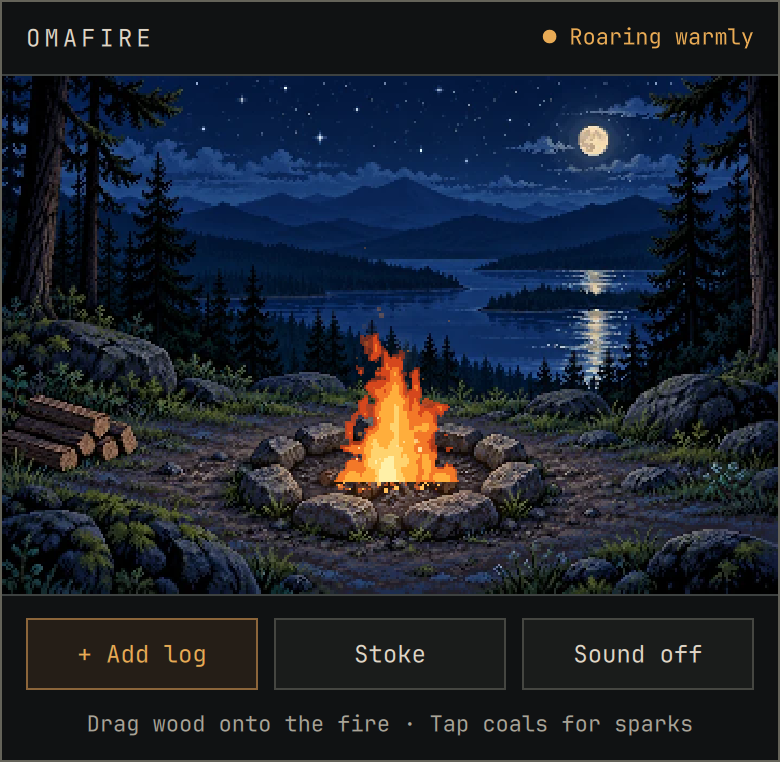
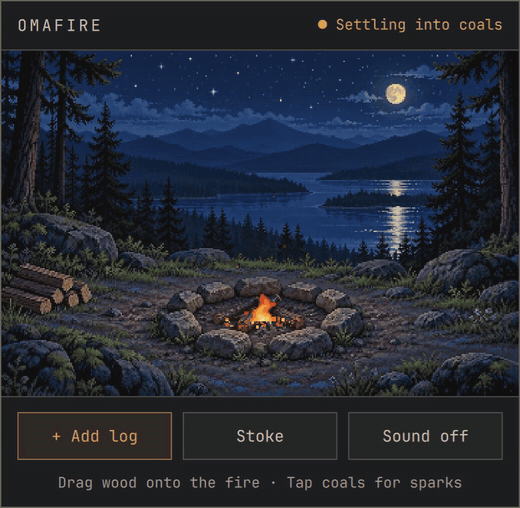
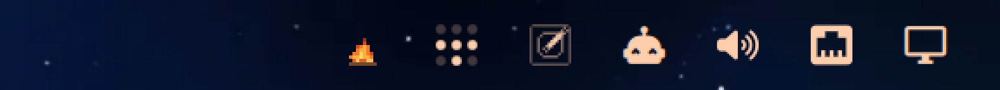

# OmaFire

A tiny campfire for your Omarchy bar.

Click the flame in the bar and a little campsite opens up. Throw a log on, stoke it, poke the coals, then go back to work and let it burn down on its own. It doesn't track anything, doesn't nag you, and won't tell you how productive you were.



```bash
omarchy plugin add https://github.com/wesleygrimes/omafire --enable
```

That's the whole install. The fire is in the right side of your bar.



## What you can do with it

- **Add a log.** Click **+ Add log**, or drag one from the woodpile at the lower left and drop it on the fire. One log is about three more minutes of fire.
- **Stoke it.** **Stoke** makes it flare up for a bit. It doesn't add wood, so stoking an empty fire pit just gets you a polite note.
- **Poke the coals.** Click the coals for a shower of sparks. Very satisfying, no practical value.
- **Listen to it.** **Sound on** plays a quiet crackle. It starts off every time and stops when the popup closes, because nobody wants a surprise fire noise in a meeting. With the sound on, crickets chirp in short phrases from off in the trees, and a frog calls now and then. Both stay soft, as if they were across the water.
- **Leave it alone.** A full load burns for about 13 minutes, down to glowing embers, then coals, then rest. It keeps burning while the popup is closed, and after a restart or a suspend it picks up where it would have been.

The bar icon is a little pixel fire that follows along, so you can tell at a glance whether it needs a log. Hover it for the status.



### Keys

While the popup is open: `A` adds a log, `S` stokes, `M` toggles sound, `Tab` moves between the buttons, `Esc` closes it.

### Keybind and scripts

OmaFire answers on the shell IPC target `wesleygrimes.omafire`:

```bash
omarchy-shell wesleygrimes.omafire toggle
omarchy-shell wesleygrimes.omafire addLog
omarchy-shell wesleygrimes.omafire status
```

The functions are `toggle`, `open`, `close`, `addLog`, `stoke`, `poke`, `sound`, and `status` (prints JSON with fuel, heat, boost, status, open, and sound).

To open it from the keyboard, add a binding to `~/.config/hypr/bindings.lua`:

```lua
o.bind("SUPER + ALT + O", "OmaFire", "omarchy-shell wesleygrimes.omafire toggle")
```

`SUPER + ALT + O` is free on a stock Omarchy 4 install. Check `omarchy-menu-keybindings --print` if you've moved things around.

## Requirements

- Omarchy 4.0 or newer with the Quickshell bar. Tested against Omarchy 4.0.6 and the 4.5 dev build, with Quickshell 0.3.2, Qt 6.12, and Hyprland 0.57.
- On Omarchy 4.0.x, OmaFire ignores the reduce motion setting, since 4.0.x doesn't have one, and `omarchy-shell` calls go through `qs ipc`, so they're a little slower than on 4.5. Everything else is the same.
- `qt6-imageformats` to load the WebP artwork.
- `qt6-multimedia` for the crackle. It's optional. Without it everything else works and the Sound button says sound isn't available.

Install either with `sudo pacman -S qt6-imageformats qt6-multimedia` if they're missing.

No network access, no web view, no background service. It's plain QML and JavaScript running inside the shell you already have.

### If it doesn't show up

Check that it's installed and enabled, then look for OmaFire in the shell log:

```bash
omarchy-version
omarchy plugin list | grep -i fire
quickshell log -p /usr/share/omarchy/shell -n | grep -i -E 'omafire|FireSession|OmaFireBar'
```

Please open an issue with that output if the fire still isn't in your bar.

## Remove it

Turn it off and keep it installed:

```bash
omarchy plugin disable wesleygrimes.omafire
```

Remove it completely:

```bash
omarchy plugin remove wesleygrimes.omafire --yes
rm -rf ~/.local/state/omafire
```

The second line deletes the saved fire (fuel and heat) and the saved panel size. OmaFire doesn't write anywhere else.

### Manual install

If you'd rather not use `omarchy plugin add`:

```bash
git clone https://github.com/wesleygrimes/omafire ~/.config/omarchy/plugins/wesleygrimes.omafire
omarchy-shell shell rescanPlugins
omarchy plugin enable wesleygrimes.omafire
```

Remove a manual install with `omarchy plugin disable wesleygrimes.omafire`, then delete that folder.

## How it works

The fire started life as a small browser prototype. OmaFire ports its drawing code into QML: the same noise, palette, sparks, smoke, light, and timing, drawn into a 360 by 240 pixel buffer and scaled up without smoothing so it stays crisp on HiDPI screens. The lake adds gently rippling moonlight and silver-blue glints. The tests check that the fire produces the same pixels as the original, frame for frame, and that the lake animation stays on the water.

It only draws while the popup is open, and then only the parts of the picture that changed. With the popup closed the cost is the bar icon, which is about 1% of one core on my VM. With it open it's roughly a fifth of one core, which is about what a small animated campfire should cost you.

State lives in `~/.local/state/omafire/state.json` (or under `$XDG_STATE_HOME`). Sound is never saved. Drag the lower-left corner to resize the panel; the width is remembered in `panel.json` beside that file, and the next open uses it. The scene stays 3:2.

More detail, including the numbers, is in [docs/NOTES.md](docs/NOTES.md).

## Development

```bash
mise run test
```

That runs the simulation tests, a pixel comparison against the original prototype (in Node and in headless Chromium), offscreen QML tests at 1x and 2x, a Quickshell integration run, and `omarchy plugin validate`. Images land in `tests/out/`.

`mise run sound` rebuilds `assets/crackle.wav` from `scripts/gen-crackle.py`, and the cricket and frog calls from `scripts/gen-night.py`.

## Credits

The campsite artwork in `assets/campsite-approved.webp` was made for this project and ships unchanged. The crackle is generated by `scripts/gen-crackle.py`. The cricket and the two frog calls are generated by `scripts/gen-night.py`.

## Contributors

Thanks to these people ([emoji key](https://allcontributors.org/docs/en/emoji-key)):

<a id="maintenance-wesleygrimes"></a>

<!-- ALL-CONTRIBUTORS-LIST:START - Do not remove or modify this section -->
<!-- prettier-ignore-start -->
<!-- markdownlint-disable -->
<table>
  <tbody>
    <tr>
      <td align="center" valign="top" width="14.28%"><a href="https://github.com/wesleygrimes"><br /><sub><b>Wes Grimes</b></sub></a><br /><a href="https://github.com/wesleygrimes/omafire/commits?author=wesleygrimes" title="Code">💻</a> <a href="https://github.com/wesleygrimes/omafire/commits?author=wesleygrimes" title="Documentation">📖</a> <a href="#maintenance-wesleygrimes" title="Maintenance">🚧</a></td>
      <td align="center" valign="top" width="14.28%"><a href="http://www.inmattsmind.com"><br /><sub><b>Matthew L. Wolfgang</b></sub></a><br /><a href="https://github.com/wesleygrimes/omafire/commits?author=mattwolfgang" title="Code">💻</a> <a href="https://github.com/wesleygrimes/omafire/commits?author=mattwolfgang" title="Documentation">📖</a></td>
      <td align="center" valign="top" width="14.28%"><a href="https://github.com/Gobbledegookie"><br /><sub><b>Gobbledegookie</b></sub></a><br /><a href="https://github.com/wesleygrimes/omafire/commits?author=Gobbledegookie" title="Code">💻</a></td>
    </tr>
  </tbody>
</table>

<!-- markdownlint-restore -->
<!-- prettier-ignore-end -->

<!-- ALL-CONTRIBUTORS-LIST:END -->

This project follows the [all-contributors](https://allcontributors.org) specification.
To contribute, see [CONTRIBUTING.md](CONTRIBUTING.md).

## Support

OmaFire is free. If it's useful, you can [sponsor the work](https://github.com/sponsors/wesleygrimes) or [buy me a coffee](https://buymeacoffee.com/ncfrontiersman).

## License

MIT. See [LICENSE](LICENSE).
