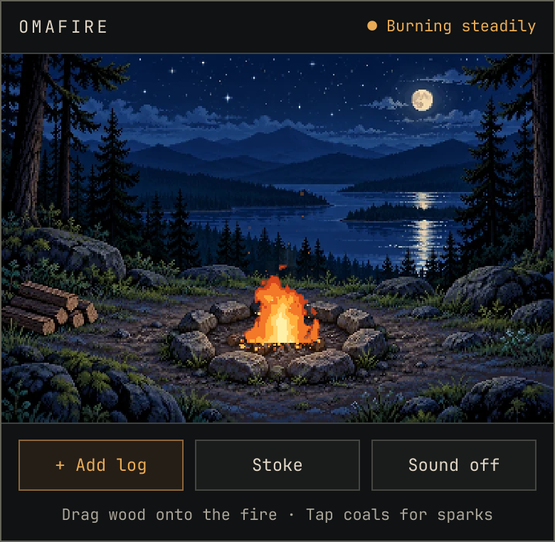

# OmaFire

A tiny campfire for the Omarchy bar. Click the flame to open it, add wood, stoke it, and let it burn down while you work. It goes from flames to coals to rest on its own. No timers, no scores, no reminders.

<!-- TODO(Wes): replace with a real screenshot from the VM -->


## Install

```bash
omarchy plugin add https://github.com/wesleygrimes/omafire --enable
```

Plugins added without `--enable` land disabled so you can read the code first. Enable it later with:

```bash
omarchy plugin enable wesleygrimes.omafire
```

### Manual install

```bash
git clone https://github.com/wesleygrimes/omafire ~/.config/omarchy/plugins/wesleygrimes.omafire
omarchy-shell shell rescanPlugins
omarchy plugin enable wesleygrimes.omafire
```

### Disable or remove

```bash
omarchy plugin disable wesleygrimes.omafire
omarchy plugin remove wesleygrimes.omafire
```

## Use it

- Click the little flame in the bar to open or close the popup.
- **+ Add log** or drag a log from the woodpile at the lower left onto the fire.
- **Stoke** makes it flare up for a bit. It doesn't add wood.
- Click the coals for a shower of sparks.
- **Sound off/on** plays a quiet crackle. It starts off and stops when the popup closes.

Keys while the popup is open: `A` adds a log, `S` stokes, `M` toggles sound, `Esc` closes, `Tab` moves between the buttons.

A full load of wood burns for about 13 minutes. One log adds about 3 minutes. The fire keeps burning while the popup is closed, and picks up where it should after a restart or suspend.

### Keybinds and scripts

OmaFire answers on the IPC target `wesleygrimes.omafire`:

```bash
omarchy-shell wesleygrimes.omafire toggle
```

Functions: `toggle`, `open`, `close`, `addLog`, `stoke`, `poke`, `sound`, and `status` (prints JSON with fuel, heat, boost, status, open, sound).

For example, a Hyprland bind in `~/.config/hypr/bindings.conf`:

```
bind = SUPER CTRL, F, exec, omarchy-shell wesleygrimes.omafire toggle
```

## Requirements

- Omarchy 4.0 (the Quickshell bar). Tested against Quickshell 0.3.2 and Qt 6.12.
- `qt6-imageformats` for the WebP background.
- `qt6-multimedia` for sound. Without it everything else still works and the Sound button says it's unavailable.

## How it works

The popup is plain QML. The fire is a port of the original browser prototype's drawing code: the same noise, palette, sparks, smoke, light, and timing, drawn into a 360 x 240 pixel buffer and scaled up without smoothing so it stays crisp on HiDPI screens. It only draws while the popup is open.

Fuel and heat are saved to `~/.local/state/omafire/state.json` (or `$XDG_STATE_HOME/omafire/state.json`). Sound isn't saved and always starts off.

More detail is in [docs/NOTES.md](docs/NOTES.md).

## Development

```bash
mise run test
```

Runs everything: simulation tests, a pixel comparison against the original prototype (in node and in headless Chromium), offscreen QML tests at 1x and 2x, a Quickshell integration run, and `omarchy plugin validate`. Images land in `tests/out/`.

`mise run sound` rebuilds `assets/crackle.wav` from `scripts/gen-crackle.py`.

## Credits

The campsite artwork (`assets/campsite-approved.webp`) was generated for this project and is used unchanged. The crackle loop is generated by `scripts/gen-crackle.py`.

## License

MIT. See [LICENSE](LICENSE).
